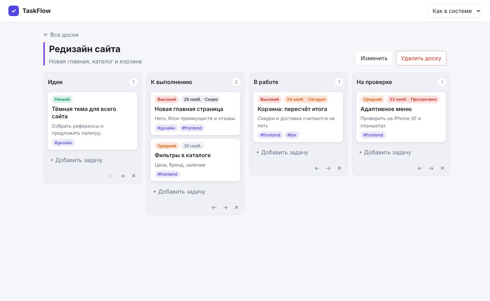
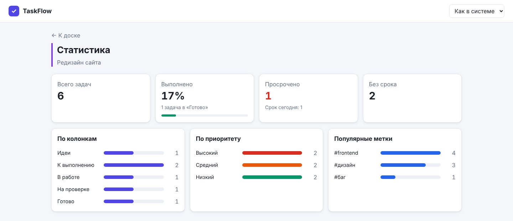

# TaskFlow

Канбан-доска задач на React и TypeScript: доски, колонки, карточки задач с приоритетами, сроками и метками, перетаскивание мышью, пальцем и с клавиатуры, поиск и фильтры, статистика по доске. Данные хранятся в браузере.

**Демо:** https://gev566.github.io/taskflow/



## Возможности

- **Доски:** создание, редактирование и удаление, выбор цвета, демо-доски при первом запуске.
- **Колонки:** добавление, переименование по клику, порядок, удаление; дубли названий не допускаются.
- **Задачи:** форма с проверкой полей — название, описание, колонка, приоритет, срок, метки. Срок подсвечивается: «Просрочено», «Сегодня», «Скоро».
- **Перетаскивание:** внутри колонки и между колонками; мышь, касание (удержание) и клавиатура (пробел и стрелки), подсказки для экранных дикторов.
- **Поиск и фильтры:** по тексту, приоритету, метке и сроку; состояние в адресной строке, поэтому ссылкой можно поделиться.
- **Статистика:** процент выполненных, просроченные, распределение по колонкам, приоритетам и меткам.
- Светлая и тёмная тема, адаптивная вёрстка для телефона.



## Стек

- React 19, TypeScript (strict), Vite
- React Router 7 — маршруты `/`, `/boards/:boardId`, `/boards/:boardId/stats`
- Zustand — состояние и сохранение в localStorage с версиями и миграциями
- dnd-kit — перетаскивание карточек
- Vitest и Testing Library — 60+ тестов: логика и пользовательские сценарии
- ESLint, GitHub Actions — линтер, проверка типов, тесты, сборка и публикация на GitHub Pages

## Запуск

```bash
npm install
npm run dev        # локальный сервер
npm test           # тесты
npm run typecheck  # проверка типов
npm run build      # сборка
```

## Как устроено

- Доски, колонки и задачи лежат в одном хранилище Zustand (`store/boards.ts`) плоскими списками со ссылками друг на друга (`boardId`, `columnId`) — как строки в базе данных. При удалении доски или колонки удаляются и их задачи.
- Вся логика — чистые функции в `utils/` с тестами: проверка форм, разбор меток, статус срока, фильтрация, перестановка задач, статистика. Компоненты только вызывают их.
- Страница подписывается на нужный кусок состояния через `useShallow`, поэтому перерисовывается только тогда, когда этот кусок действительно изменился.
- Перетаскивание на dnd-kit: мышь начинает тащить после сдвига на 5px (иначе это клик и задача открывается), палец — после удержания 200 мс, чтобы не мешать прокрутке. Куда встанет карточка, считает функция `moveToColumn`.
- Фильтры живут в адресной строке (`?q=&priority=&tag=&due=`): «назад» в браузере работает, неизвестные значения игнорируются. Пока фильтр включён, перетаскивание выключено — иначе позиция среди скрытых карточек была бы непонятной.
- Срок хранится строкой `YYYY-MM-DD`, а «сегодня» считается по местному времени, а не по UTC, иначе вечером день мог бы сдвинуться.
- Модальные окна — нативный `<dialog>`: фокус и закрытие по Esc браузер даёт сам. Поля форм связаны с ошибками через `aria-describedby`.
- У сохранённых данных есть версия: при изменении формата `migrate` переводит старые данные в новый вид без потери досок пользователя.
- На GitHub Pages прямые ссылки на доски работают благодаря копии `index.html` в `404.html`.

## Структура

```
src/
  components/   Layout, Modal, ConfirmDialog, BoardForm, ColumnView, AddColumn,
                TaskCard, SortableTask, TaskForm, TaskFiltersBar
  pages/        список досок, доска, статистика, 404
  store/        хранилища Zustand и демо-данные
  utils/        валидация, задачи, фильтры, статистика, перестановка, форматирование
  types.ts      типы данных
```
